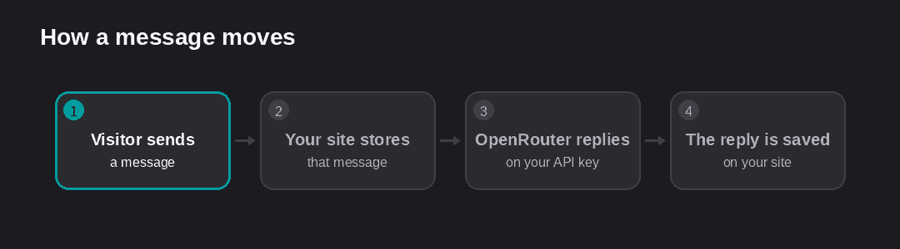
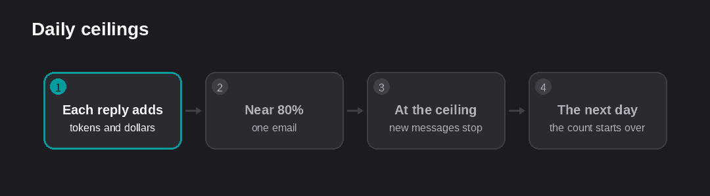
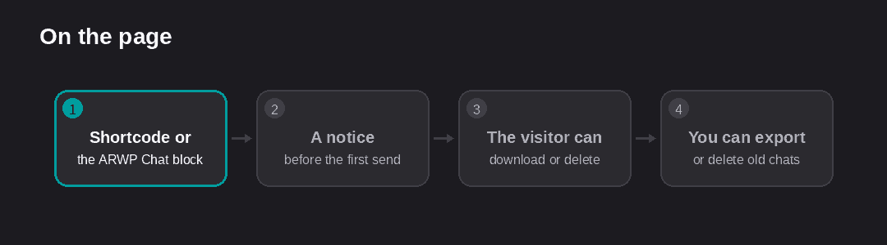

# ARWP Agents

A chat on any page, with your own OpenRouter key. The conversation stays on your site.

[ARWP Agents on WordPress.org](https://wordpress.org/plugins/arwp-agents/)

You create an agent, write how it should behave, and place it with the shortcode `[arwp id="123"]` or the ARWP Chat block. Replies are charged to the API key you save in Settings, or to `ARWP_OPENROUTER_API_KEY` in `wp-config.php`.

## How a message moves

The visitor's message is stored before anything is sent. OpenRouter then receives that message, the agent's prompt, the recent turns from the same chat, and that agent's model settings. The reply is saved on your site. Nothing is sent until someone uses a published chat.

## Daily ceilings

Settings can stop new messages for the whole site after a daily token ceiling or a daily dollar ceiling. Both start off. `0` leaves that ceiling off.

The token ceiling counts every reply. The dollar ceiling counts only the cost OpenRouter reports. Near 80% of either ceiling, the plugin emails you once. When a ceiling is reached, new messages stop until the next day, and you get one more email.

Hourly limits still apply per visitor, per account, per role, and per agent. A new agent waits 5 seconds between messages in the same chat.

## On the page

The ARWP Chat block places the same chat as the shortcode. Before the first send in a browser session, the visitor has to accept a notice that the message leaves the site for OpenRouter.

A visitor can download or delete their own chat. Under ARWP Agents → Chats, an administrator can download a CSV of the list or a transcript of one conversation. Settings can delete chats older than a chosen number of days. `0` keeps them.

Names and contact details stay hidden on that screen until an administrator turns that on.

## Requirements

- WordPress 6.2 or newer
- PHP 7.4 or newer
- An OpenRouter API key
